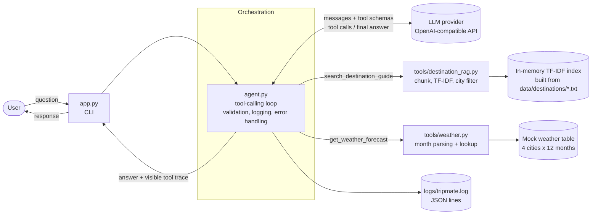

# TripMate: Agentic AI Travel Assistant

TripMate answers natural-language travel questions (visa/entry, weather, packing, safety, local customs) for four destinations: **Tokyo, Reykjavik, Bangkok and Barcelona**. An LLM decides, per question, which tools to call, runs them in the right order, and writes one combined answer. Every tool call is shown in a visible trace and written to a structured log.

**Video walkthrough:** _add your Loom link here_

## Features

| Requirement | How it is covered |
|---|---|
| Agent core | `agent.py`: a raw function-calling loop (no framework), bounded to 5 tool rounds |
| Destination guide tool (RAG) | `tools/destination_rag.py`: city-aware TF-IDF retrieval over the supplied guides |
| Weather tool | `tools/weather.py`: mock table for 4 cities x 12 months, flexible month parsing |
| Multi-tool reasoning | Packing questions call both tools and combine the results |
| Scope awareness | Booking and unrelated requests are refused with no tool calls and no fabricated actions |
| Visible reasoning trace | Each call shows tool, reason, arguments and result; the same data goes to `logs/tripmate.log` |

## Architecture



**Request flow:** the CLI passes the question to `agent.py`, which validates it and sends it to the LLM with the tool schemas. The LLM returns tool calls; the agent validates the arguments, runs only registered tools, logs everything, and sends the results back. The LLM then calls more tools or writes the final answer, and the CLI prints the answer and the trace. More detail is in [architecture.md](architecture.md).

## Project structure

```
tripmate-agent/
├── app.py                  # CLI entry point
├── agent.py                # orchestration: LLM loop, tool schemas, error handling
├── config.py               # settings from environment variables
├── logging_setup.py        # JSON-lines logging
├── tools/
│   ├── destination_rag.py  # search_destination_guide
│   └── weather.py          # get_weather_forecast
├── data/destinations/      # tokyo.txt, reykjavik.txt, bangkok.txt, barcelona.txt
├── tests/                  # unit, tool-selection and integration tests
├── scripts/generate_examples.py   # fills the example runs below from real runs
├── architecture.md
└── requirements.txt
```

## Setup

Requires Python 3.10+ and an API key for an OpenAI-compatible LLM provider (OpenAI, Groq, or similar).

```powershell
python -m venv .venv
.venv\Scripts\activate
pip install -r requirements.txt
Copy-Item .env.example .env
```

Edit `.env`:

```
OPENAI_API_KEY=your_key
OPENAI_MODEL=model_name_that_supports_tool_calling
OPENAI_BASE_URL=            # leave empty for OpenAI; set it for other providers
```

For example, with Groq: `OPENAI_BASE_URL=https://api.groq.com/openai/v1` and a tool-calling model from Groq's model list. `.env` is git-ignored; never commit it.

## Run

```powershell
python app.py
```

Try: `What are the local customs in Tokyo?`, `What should I pack for Tokyo in March?`, `Can you book a flight to Barcelona?`. Type `exit` to quit.

## Tests

```powershell
python -m pytest -q
```

- **Tool unit tests:** `tests/test_rag.py`, `tests/test_weather.py` (valid input, unknown city, bad or missing input, month formats, city filtering).
- **Tool-selection tests** (`tests/test_agent.py`): single-tool (guide only, weather only), multi-tool and no-tool flows, using a scripted fake LLM so they run without an API key. These verify the orchestration (dispatch, trace, argument handling), not the model's own judgment.
- **Integration test:** the full packing flow, from question through both tools to the final answer.
- **Error-handling tests:** empty and over-long input, unknown city, malformed tool arguments, LLM failure.
- **Live tool-selection test** (`tests/test_live_tool_selection.py`): checks that the real LLM picks the expected tools for four sample queries. It is skipped when no API key is set.

## Tool schemas (as given to the LLM)

<!-- TOOL_SCHEMAS_START -->
```json
[
  {
    "name": "search_destination_guide",
    "description": "Search the supplied destination guides (Tokyo, Reykjavik, Bangkok, Barcelona) for visa/entry, customs, best time to visit, packing, or safety information.",
    "parameters": {
      "type": "object",
      "properties": {
        "query": {
          "type": "string",
          "description": "Natural-language question or topic; include the city name"
        },
        "top_k": {
          "type": "integer",
          "description": "Number of relevant chunks, from 1 to 5",
          "minimum": 1,
          "maximum": 5
        },
        "reason": {
          "type": "string",
          "description": "One short sentence: why this tool is being called"
        }
      },
      "required": [
        "query"
      ],
      "additionalProperties": false
    }
  },
  {
    "name": "get_weather_forecast",
    "description": "Get illustrative mock weather (conditions and temperature range in C) for a supported city and a month or date.",
    "parameters": {
      "type": "object",
      "properties": {
        "city": {
          "type": "string"
        },
        "date_or_month": {
          "type": "string",
          "description": "Month name (e.g. March) or an ISO date"
        },
        "reason": {
          "type": "string",
          "description": "One short sentence: why this tool is being called"
        }
      },
      "required": [
        "city",
        "date_or_month"
      ],
      "additionalProperties": false
    }
  }
]
```
<!-- TOOL_SCHEMAS_END -->

The system prompt tells the model to use the guide for visa, customs, packing, best-time and safety questions, the weather tool for weather, **both** for packing questions, no tools for requests it cannot do, and to give a one-sentence `reason` with every tool call.

## Example runs

These are real runs of the agent, generated by `scripts/generate_examples.py` (results are truncated for readability). Weather values are mock data.

<!-- EXAMPLE_RUNS_START -->
### Example 1: Single tool: destination guide

**Input:** `What are the local customs in Tokyo?`

```text
Tool:      search_destination_guide
Why:       Retrieve information on local customs in Tokyo for the user
Arguments: {'query': 'Tokyo local customs', 'top_k': 3}
Result:    ["Source: tokyo.txt\nTokyo, Japan\nLOCAL CUSTOMS\nBowing is a common greeting. Tipping is not customary and can even cause confusion. It's considered polite to be quiet on trains and to remove shoes when entering homes and certain traditional accommodations. Queuing in an orderly fashion is expected everywhere.", "Source: tokyo.txt\nTokyo, Japan\nSAFETY & HEALTH\nJapan is generally considered very safe with low crime rates. The main natural hazar ...(truncated)

```

**Answer:** Here are some of the key local customs to keep in mind when visiting Tokyo:

- **Bowing** – Bowing is the traditional way to greet, thank, or apologize. A slight bow is usually sufficient for casual interactions; deeper bows are reserved for more formal occasions.  
- **Tipping** – Tipping is not customary in Japan and can even cause confusion. Good service is considered the standard, so you don’t need to leave a tip at restaurants, hotels, or taxis.  
- **Quiet on public transport** – It’s considered polite to keep conversations low‑volume (or silent) on trains and buses. Many commuters also avoid phone calls while on board.  
- **Shoes off indoors** – When entering a private home, traditional inns (ryokan), temples, or some restaurants with tatami flooring, you’ll be expected to remove your shoes and wear the provided slippers.  
- **Queueing** – Orderly lines are the norm everywhere—from subway stations to convenience stores. Cutting in line is seen as rude.  

These customs help you blend in respectfully and enjoy a smooth experience in Tokyo.

### Example 2: Multi-tool: guide + weather (packing)

**Input:** `What should I pack for Tokyo in March?`

```text
Tool:      search_destination_guide
Why:       Retrieve packing recommendations for Tokyo in March
Arguments: {'query': 'Tokyo packing advice March', 'top_k': 3}
Result:    ["Source: tokyo.txt\nTokyo, Japan\nBEST TIME TO VISIT\nSpring (March–May) is popular for cherry blossoms, with mild temperatures. Autumn (September–November) offers similarly mild weather and autumn foliage. Summer (June–August) is hot and humid with a rainy season in June. Winter (December–February) is cool and dry, generally the least crowded season.", "Source: tokyo.txt\nTokyo, Japan\nPACKING TIPS\nLayered clothing works well given seasonal va ...(truncated)

Tool:      get_weather_forecast
Why:       Obtain mock weather conditions and temperature range for Tokyo in March
Arguments: {'city': 'Tokyo', 'date_or_month': 'March'}
Result:    {"city": "Tokyo", "period": "March", "conditions": "cool to mild, some rain (mock estimate)", "temp_range_c": [5, 14], "source": "mock"}

```

**Answer:** Here’s a concise packing list for a March trip to **Tokyo**, blending the guide’s recommendations with the mock weather forecast for that month:

| Item | Why You Need It | Notes |
|------|----------------|-------|
| **Light to medium‑weight layers** (e.g., long‑sleeve shirts, thin sweaters, a light jacket) | Temperatures in March typically range from **5 °C to 14 °C** (cool to mild) and can shift throughout the day. | Layering lets you add or remove pieces as it warms up in the afternoon or cools down in the evening. |
| **Water‑resistant jacket or compact umbrella** | The mock forecast notes **some rain** in March. | A breathable, packable rain layer keeps you dry without adding bulk. |
| **Comfortable walking shoes** | Tokyo involves a lot of walking and train travel; comfortable shoes are essential. | Choose shoes that are broken‑in and suitable for both city streets and occasional park walks (e.g., cherry‑blossom viewing spots). |
| **Scarf or light shawl** | Early mornings and evenings can feel chilly, especially near the river or in parks. | Easy to slip on/off and adds extra warmth without heavy bulk. |
| **Socks and underwear** | Standard travel basics. | Consider moisture‑wicking fabrics if you plan on doing a lot of walking. |
| **Travel‑size toiletries** | General packing tip. | Remember that many hotels provide basic shampoo/soap, but you may prefer your own. |
| **Plug adapter (Type A/B)** | Japan uses Type A (flat two‑pin) and Type B (flat three‑pin) plugs, 100 V. | A universal adapter covers this; voltage converters are rarely needed for low‑power devices. |
| **Reusable water bottle** | Staying hydrated while exploring the city. | Tap water is safe to drink in Tokyo. |
| **Small daypack or tote** | To carry layers, umbrella, and any purchases while sightseeing. | Look for a bag with a zip for security. |
| **Mask (optional)** | While mask mandates have eased, many locals still wear masks in crowded indoor spaces. | A pack of disposable or reusable masks can be handy. |

### Quick Tips
- **Layering is key**: A thin base layer, a sweater, and a light rain jacket will cover most weather scenarios.
- **Comfort first**: Prioritize shoes you can walk in for long periods; Tokyo’s subway stations involve a lot of stairs and walking.
- **Pack light**: Since March weather is moderate, you won’t need heavy winter gear, keeping your luggage manageable.

*The weather information above is a **mock illustrative forecast** and should be double‑checked closer to your travel dates.*

### Example 3: Out of scope: booking request

**Input:** `Can you book a flight to Barcelona?`

```text
(no tools called)

```

**Answer:** I’m sorry, but I can’t make flight reservations. If you’d like help with travel information for Barcelona—such as visa requirements, packing tips, the best time to visit, or anything else—just let me know!

### Example 4: Unsupported destination

**Input:** `What is the weather in Paris in May?`

```text
(no tools called)

```

**Answer:** I’m sorry, but I don’t have information on Paris. I can help with travel details for Tokyo, Reykjavik, Bangkok, or Barcelona. Let me know if you’d like information about any of those destinations!
<!-- EXAMPLE_RUNS_END -->

## Logging

`logs/tripmate.log` holds one JSON object per line: `user_query`, `tool_call` (tool, arguments, reason), `tool_result`, `tool_error`, `llm_error` and `final_answer`. Warnings and errors also appear on the console; routine events go only to the file so the CLI stays readable.

## Error handling

| Scenario | Behaviour |
|---|---|
| Empty or over-long input | Rejected with a clear message before any LLM call |
| Unsupported destination | Prompt tells the model to say it is not covered rather than use another city's content; weather returns an error listing supported cities |
| Missing weather data or unreadable month | Weather tool returns an error (never invented data), listing valid months |
| Ambiguous query | Prompt asks the model for one short clarifying question |
| Out-of-scope request (booking, unrelated topics) | No tools called; the assistant states it cannot do it |
| Tool exception or malformed tool arguments | Caught, logged, returned to the LLM as an error result |
| LLM failure (bad key, no credit, wrong model, network) | Friendly message by error type; logged; the app does not crash |
| Runaway loops | Capped at 5 tool rounds |

## Design decisions and assumptions

- **Raw function calling, no framework.** With two tools, a ~100-line loop is easy to read, test and explain, and every step is visible.
- **OpenAI-compatible client with a configurable base URL.** The same code runs on OpenAI, Groq or similar providers by changing `.env`.
- **TF-IDF retrieval instead of embeddings.** The knowledge base is four short documents, so a local in-memory index avoids extra services and keys. Chunks are split by section heading and tagged with the city. If the query names a known city or country, only that city is searched, which fixed a bug where another city's chunks ranked first.
- **Mock weather.** Free forecast APIs only cover about two weeks ahead, so they cannot answer "weather in March". A 12-month lookup keeps the demo reliable. Values are rough climate estimates, labelled `source: mock`, and the model is told to say so.
- **Visible `reason` per tool call.** The model supplies a one-sentence justification as a tool argument. It is a short stated rationale, not hidden chain-of-thought.
- **Layering.** Tools contain no LLM code; the agent contains no retrieval or weather logic; configuration and logging are separate modules.
- **Assumptions:** the supplied guides are simplified reference data, not authoritative visa or safety advice. The assistant is single-turn (no conversation memory).

## Known limitations

- TF-IDF is lexical: it can miss paraphrases and synonyms that share no words with the guide text.
- Weather is mock data, not a live forecast, and has monthly resolution only.
- If a user names a destination that is not covered, retrieval falls back to searching all cities; the prompt (not code) prevents the model from using another city's content.
- No conversation memory; each question is independent.
- Only four destinations; the model's tool choices depend on the provider's model quality.
- The CLI is minimal by design.

## Suggested future improvements

- Replace TF-IDF with embeddings and a vector store (FAISS or Chroma), with hybrid keyword + vector search and reranking.
- Use a real weather API (for example Open-Meteo) for near-term dates, with the mock table as a fallback and timeouts and retries.
- Add conversation memory so follow-ups like "and in April?" work.
- Add a hard code-level check for unsupported destinations.
- Add a web or chat UI and streaming responses.
- Add evaluation sets that measure tool-selection accuracy across many phrasings.

## Scalability considerations

**RAG from 4 cities to several hundred.** Keep the per-city, per-section chunking and store `city`, `section` and `source` as metadata. Use an embedding model and a vector database (FAISS, Chroma, pgvector) with metadata filters, so a query first narrows to the named destination and then ranks within it. Build the index offline in an ingestion job and update it incrementally instead of rebuilding at startup. Combine keyword and vector search and rerank the top results.

**Avoiding redundant tool and LLM calls.** Cache retrieval results and weather lookups with normalised keys such as (city, month). Cache final answers for identical or semantically near-identical questions, using a short expiry because guide data can change. Skip the LLM entirely for exact repeats.

**Reducing LLM cost at higher volume.** Route simple questions to a smaller, cheaper model and reserve a larger one for multi-step or ambiguous requests. Keep prompts and retrieved context short (smaller `top_k`, trimmed chunks), use provider prompt caching for the fixed system prompt and tool schemas, set token limits, and monitor cost per request.

**Keeping tool selection fast as tools grow.** Write short, distinct tool descriptions. When there are dozens of tools, first select a small candidate set (by tool category or an embedding match between the query and tool descriptions) and give the LLM only those schemas. Allow parallel tool calls for independent tools, and track latency per step.
