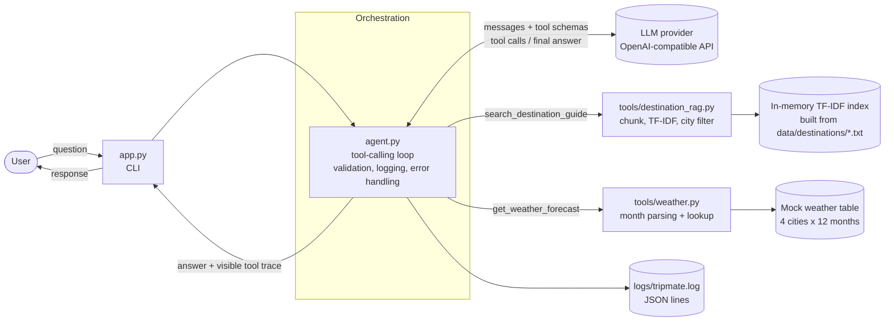

# TripMate architecture

## How a request flows

1. The user types a question in the CLI (`app.py`).
2. `agent.py` validates it (not empty, not too long) and sends it to the LLM together with the tool schemas.
3. The LLM decides, per question, which tools to call (none, one or both) and with what arguments.
4. `agent.py` validates the arguments and runs only registered tools. Each call, result and error is logged as JSON.
5. Tool results go back to the LLM, which can call more tools or write the final answer.
6. The CLI prints the answer and the visible tool trace (tool, reason, arguments, result).

## Layers

| Layer | Files | Responsibility |
|---|---|---|
| Interface | `app.py` | Read input, print answer and trace |
| Orchestration | `agent.py` | LLM loop, tool dispatch, validation, error handling |
| Tools | `tools/destination_rag.py`, `tools/weather.py` | Business logic, no LLM code |
| Config and logging | `config.py`, `logging_setup.py` | Environment settings, JSON logs |
| Data | `data/destinations/*.txt` | Destination guides for Tokyo, Reykjavik, Bangkok, Barcelona |
